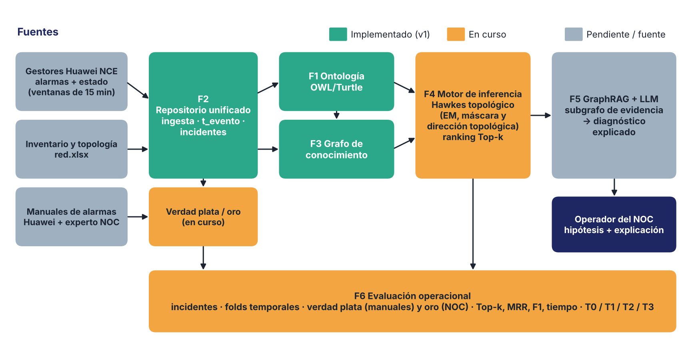
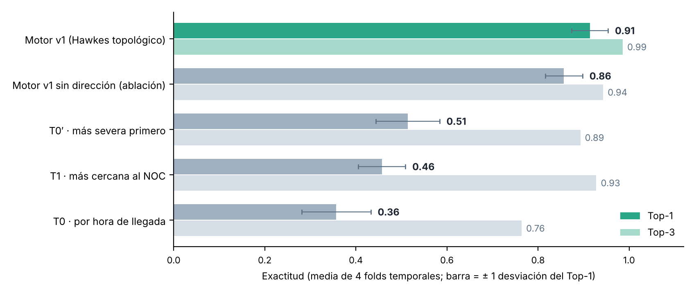
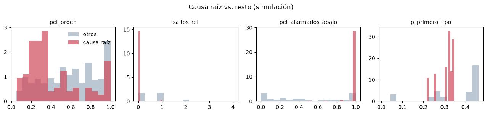

# Resultados del motor de inferencia v1 (avance al cierre del Sprint 2)

> **Nota sobre los datos.** Este repositorio es público y **no contiene datos del operador** (alarmas, inventario,
> topología, IPs ni nombres de equipos). Los notebooks se publican sin salidas y se ejecutan en la máquina autorizada
> del operador. Aquí se resumen los resultados agregados, que no permiten reconstruir la red.

## Arquitectura de la solución

## Datos procesados (agregados)

| Indicador | Valor |
|---|---|
| Descargas del gestor NCE analizadas | 313 ventanas (2 al 15 de octubre de 2026) |
| Alarmas de red (sin radios hacia clientes) | 51 533 |
| Alarmas nuevas / reaparecidas (crónicas, descartadas) | 1 346 / 538 |
| Incidentes delimitados (alarmas nuevas conectadas, ≤ 4 saltos, ≥ 3 alarmas) | 44 (697 alarmas; 43 de transporte y 1 de acceso) |
| Grafo de conocimiento | 1 184 nodos, 1 586 relaciones, un componente conectado |
| Ontología v1 | 17 clases, 10 propiedades de objeto, 14 de datos |

## Motor v1: proceso de Hawkes topológico (`src/motor.py`, `notebooks/07_motor_v1.ipynb`)

Aprende **sin etiquetas** qué tipo de alarma dispara a cuál (α), restringido por la topología (atenuación por salto y
dirección aguas abajo), y ordena los equipos de cada incidente por `P(espontánea) × (1 + alarmas que explica)`.

### Evaluación con causa conocida (avalanchas simuladas sobre la topología real; 4 particiones temporales)

| Método | Top-1 | Top-3 | MRR | Equipos revisados |
|---|---|---|---|---|
| **T3 · Motor v1 (Hawkes topológico)** | **0,914 ± 0,040** | **0,986 ± 0,017** | **0,944 ± 0,027** | **1,17 ± 0,09** |
| T3 sin dirección aguas abajo (ablación) | 0,857 ± 0,041 | 0,943 ± 0,033 | 0,907 ± 0,026 | 1,34 ± 0,10 |
| T0′ · la más severa primero | 0,514 ± 0,070 | 0,893 ± 0,043 | 0,709 ± 0,037 | 1,88 ± 0,10 |
| T1 · la más cercana al núcleo primero | 0,457 ± 0,052 | 0,928 ± 0,028 | 0,684 ± 0,027 | 1,90 ± 0,07 |
| T0 · por hora de llegada | 0,357 ± 0,076 | 0,764 ± 0,049 | 0,587 ± 0,046 | 2,62 ± 0,25 |

McNemar T3 frente a T0′: 56 incidentes acertados solo por el motor y 0 solo por la referencia (p < 0,001).
Detalle por partición: [`results/motor_v1/`](results/motor_v1/).

### Lo que aprendió el motor en la red real (sin etiquetas ni manuales)

| Par causa → efecto | α |
|---|---|
| Local Fault Alarm → Interface IPv6 status changed | 1,27 |
| L3VPN VRF Down → Bgp Peer Backward Transition | 1,12 |
| R_LOS → MUT_LOS | 0,96 |
| Interface IPv6 status changed → IS-IS Adjacency Changed | 0,90 |
| Alarm of failed LAG negotiation → Alarm that all LAG bandwidth is lost | 0,88 |
| NE_NOT_LOGIN → NE_COMMU_BREAK | 0,76 |

Versión v0.2c, ejecutada en la máquina del operador el 22-nov-2026; los resultados de la simulación coinciden exactamente
con los del entorno de desarrollo.

## Limitaciones y próximos pasos

- La exactitud proviene de una **simulación** que favorece la restricción topológica del motor: es un techo optimista.
  La métrica de la tesis será la medida con la etiqueta **oro** (NOC), hoy en revisión, y la **plata** (manuales Huawei).
- Versiones: `v0.2b` (primera corrida real) → `v0.2c` (estructura de parentesco acíclica, hora del evento,
  particiones por incidentes). En la simulación, el Top-1 pasó de 0,772 a 0,914.
- Siguiente: búsqueda de hiperparámetros, validación con el NOC y capa GraphRAG + LLM (Sprint 5).
