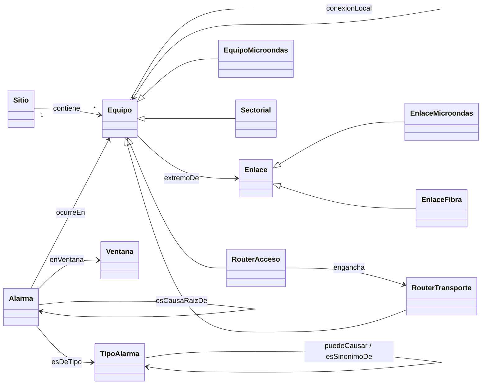

# 03 · Ontología mínima del dominio (Sprint 2)

> Entregable de la tarjeta *"Grafo de conocimiento v1 + ontología mínima"*.
> Formaliza el dominio (**OE1**) y es el esquema que instancia el grafo de conocimiento (**OE3**).
> Versión formal (OWL/Turtle): `docs/ontologia_v1.ttl`. Implementación: `src/grafo.py`.

## 1. Propósito y alcance

Representar la red de transporte y acceso de Pasco y sus alarmas de modo que el motor de inferencia pueda razonar
sobre **causa → efecto siguiendo la topología**: una alarma en un equipo «aguas arriba» puede explicar las alarmas
de los equipos que dependen de él. Es **mínima**: solo incluye lo necesario para el diagnóstico v1.

## 2. Decisiones de diseño

| Decisión | Justificación |
|---|---|
| Granularidad **sitio → equipo → extremo de enlace** | Es la unidad estable de la red. En microondas cada IDU es un extremo de enlace, así que la precisión llega al enlace. |
| El **puerto no es una clase**; es un atributo de la alarma (`moi_puerto`) | Los puertos migran por averías: modelarlos como nodos fijos obligaría a actualizar el grafo continuamente. Así se cumple el nivel de puerto del **OE3**: el grafo llega al extremo de enlace y cada alarma conserva su puerto. |
| **Sectorial** (RTN510_AP) es una clase propia, fuera del diagnóstico | No afecta la conectividad del nodo; sus alarmas forman un indicador de salud de clientes. |
| **Enganche acceso → transporte**: router del nodo distrital (AD) ↔ router de transporte (TT) del mismo sitio | Confirmado con el NOC. Una excepción documentada (en data/raw/reglas_red.json, no versionado) |
| **NOC Acceso ↔ NOC Transporte** | Confirmado con el NOC: los routers de agregación de acceso se conectan al NOC de transporte. |
| **RDNFO** como sitio externo y **ruta de respaldo** | Frontera con la Red Dorsal Nacional; no está en el inventario. Según el NOC funciona como respaldo o para agregar tráfico hacia el NOC (p. ej. el bus de Oxapampa sale por Auquimarca o por la RDNFO). La ruta **principal** de cada sitio se calcula por la red propia; la RDNFO solo cuenta como alternativa al medir la criticidad. |
| **Enlace óptico** entre los dos OptiX OSN 1800 (en data/raw/reglas_red.json) | Confirmado con el NOC. *Supuesto a validar:* cada OptiX está cableado a los routers de transporte de su sitio (aristas con `supuesto=True`). |
| **Criticidad** de cada sitio (`dependientes`) | Nº de sitios que pierden conexión al núcleo si ese sitio falla, contando el respaldo. Una alarma en un sitio crítico es buena candidata a explicar las avalanchas de los sitios que dependen de él. |
| Cluster y anillo como **atributos** (v1) | Basta para filtrar y para las features; pueden pasar a clase si el motor lo requiere. |

## 3. Clases

| Clase | Subclases | Instancias en la red de Pasco | Fuente |
|---|---|---|---|
| `Sitio` | `SitioTransporte`, `SitioAcceso`, `SitioExterno` | 279 sitios + RDNFO | `nodos` (`CODIGO DE NODO`) |
| `Equipo` | `RouterAcceso`, `RouterTransporte`, `RouterAgregacionAcceso`, `EquipoMicroondas`, `EquipoOpticoTransporte`, `Sectorial` | 1 099 equipos | `nodos` (`NOMBRE DE EQUIPO EN RED`, `TIPO`) |
| `Enlace` | `EnlaceMicroondas`, `EnlaceFibra` | 201 de acceso + 49 de transporte | `topologia_ax`, `topologia_tx` |
| `Alarma` | — | una por registro de alarma | JSON de alarmas (ingesta) |
| `TipoAlarma` | — | cada `alarmName` distinto | JSON de alarmas |
| `Ventana` | — | una por descarga de 15 min | carpeta `DD_MM_AAAA_HH_MM_SS` |

## 4. Relaciones (propiedades de objeto)

| Relación | Dominio → Rango | Significado | Fuente |
|---|---|---|---|
| `contiene` | `Sitio` → `Equipo` | el equipo está instalado en el sitio | `nodos` |
| `conexionLocal` | `Equipo` ↔ `Equipo` | cableado dentro del sitio: router ↔ IDU de microondas, router ↔ sectorial | `topologia_ax` + regla del NOC |
| `extremoDe` | `Equipo` / `SitioExterno` → `Enlace` | el equipo es uno de los dos extremos del enlace (IDU en microondas, router en fibra) | `topologia_ax`, `topologia_tx` |
| `engancha` | `RouterAcceso` / `RouterAgregacionAcceso` → `RouterTransporte` | conexión de la red de acceso hacia el transporte (dirección: hacia el núcleo) | regla confirmada con el NOC |
| `ocurreEn` | `Alarma` → `Equipo` | equipo que levantó la alarma (por IP) | ingesta (`address` = `IP_Equipo`) |
| `enVentana` | `Alarma` → `Ventana` | ventana de descarga de la alarma | ingesta (`ventana_id`) |
| `esDeTipo` | `Alarma` → `TipoAlarma` | tipo de la alarma | `alarmName` |
| `puedeCausar` | `TipoAlarma` → `TipoAlarma` | relación causa → efecto candidata entre tipos | datos + manuales Huawei + experto |
| `esSinonimoDe` | `TipoAlarma` ↔ `TipoAlarma` | dos nombres para el mismo evento (p. ej. la pareja BGP del EDA) | datos + manuales Huawei |
| `esCausaRaizDe` | `Alarma` → `Alarma` | salida del motor (o etiqueta de referencia) | motor / NOC |

## 5. Atributos (propiedades de datos)

- **Sitio:** `codigo`, `nombre`, `tipoNodo` (TERMINAL, INTERMEDIO, DISTRITAL, DISTRIBUCION, …), `red` (tx/ax),
  `cluster` (acceso), `anillos` (transporte).
- **Equipo:** `nombre`, `ip`, `tipo` (modelo), `rol`, `red`.
- **Enlace:** `codigo`, `medio` (microondas/fibra), `red`, `cluster` o `anillos`.
- **Alarma:** `alarmName`, `severidad`, `firstOccurUtc`, `arriveUtc`, `moi_puerto`, `activa`.

## 6. Diagrama



Camino físico típico en acceso (según el NOC):

```
Router N1 ── IDU1 N1 ~~~~ microondas ~~~~ IDU1 N2 ── Router N2
         └── IDU2 N1 ~~~~ microondas ~~~~ IDU2 N3 ── Router N3
```

En el grafo: `Router N1 —conexionLocal— IDU1 N1 —extremoDe— Enlace —extremoDe— IDU1 N2 —conexionLocal— Router N2`.

## 7. Estado de implementación (grafo v1)

- **Implementado** (`src/grafo.py`): `Sitio`, `Equipo`, `Enlace` y las relaciones `contiene`, `conexionLocal`,
  `extremoDe`, `engancha`; ubicación de cada alarma en su equipo (`ocurreEn`).
- **Siguiente paso** (subtarea *Modelar relaciones causales candidatas*): poblar `puedeCausar` y `esSinonimoDe`
  entre tipos de alarma a partir de los datos (co-ocurrencia + orden temporal sobre equipos vecinos en el grafo) y de
  los manuales de alarmas Huawei, y validarlas con el experto del NOC.
